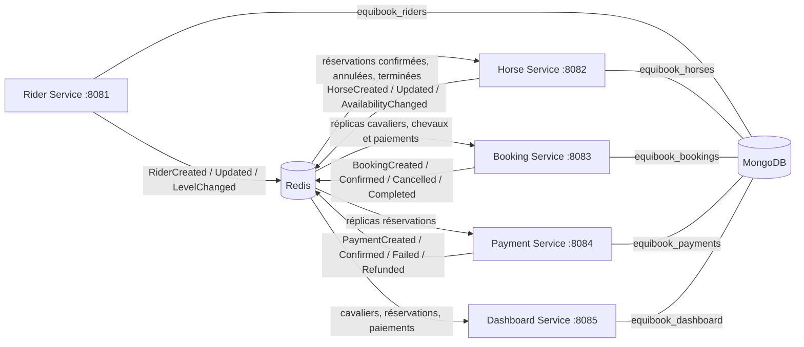

# EquiBook - Plateforme de réservation de séances d’équitation

## 1. Présentation d'EquiBook

EquiBook gère les cavaliers, les chevaux, les réservations de séances et leurs paiements. Un tableau de bord par cavalier est alimenté par les événements des services. Le projet utilise Java 21, Spring Boot 3.5.16, Gradle 8.14.3, MongoDB 7 et Redis 7.4. Les cinq services sont exécutables indépendamment.

Le support architectural du cours est [rentalservice](https://github.com/charroux/rentalservice). EquiBook en reprend le découpage en services, les contrats JSON et la distribution d’événements par listes Redis, avec les agrégats MongoDB demandés.

## 2. Membres du groupe

- Ilyesse EL ADAOUI

## 3. Architecture



Les services n’effectuent aucun appel REST entre eux. Le dossier `shared/` contient du code de transport, de stockage et de validation compilé dans chaque service ; il ne constitue pas un service supplémentaire. Chaque module contient son application Spring Boot, son contrôleur, son domaine et sa configuration.

```text
equibook/
├── README.md
├── VERIFICATION.md
├── build.gradle / settings.gradle / gradlew / gradlew.bat
├── gradle/wrapper/
├── Dockerfile / docker-compose.yml / .env.example
├── contracts/
│   ├── commands/     (14 JSON Schema)
│   ├── aggregates/   (5 JSON Schema)
│   ├── events/       (14 JSON Schema)
│   └── replicas/     (3 JSON Schema)
├── shared/src/main/java/fr/equibook/core/
├── shared/src/test/java/fr/equibook/core/
├── rider-service/
├── horse-service/
├── booking-service/
├── payment-service/
├── dashboard-service/
├── http/
├── scripts/
└── .github/workflows/build.yml
```

## 4. Responsabilité de chaque service

| Service | Responsabilité | Port par défaut |
|---|---|---|
| rider-service | Créer et modifier les cavaliers et leur niveau | 8081 |
| horse-service | Gérer les chevaux et leur disponibilité | 8082 |
| booking-service | Valider les réplicas locaux, réserver et gérer les séances | 8083 |
| payment-service | Gérer le cycle de vie des paiements des réservations | 8084 |
| dashboard-service | Construire et exposer les projections par cavalier | 8085 |

## 5. Commandes

| Service | Commandes |
|---|---|
| Rider | CreateRider, UpdateRider, ChangeRiderLevel |
| Horse | CreateHorse, UpdateHorse, ChangeHorseAvailability |
| Booking | CreateBooking, ConfirmBooking, CancelBooking, CompleteBooking |
| Payment | CreatePayment, ConfirmPayment, FailPayment, RefundPayment |

Les fichiers de `contracts/commands/` sont des JSON Schema 2020-12, pas des données préremplies. Chaque commande contient `commandId` (UUID), `commandType`, `occurredAt` (ISO-8601 avec fuseau) et `payload`. L’API vérifie le type attendu par la route et les champs métier ; les champs inconnus sont refusés. Pour les modifications, l’identifiant de l’agrégat est dans l’URL. Le payload des commandes de transition est un objet vide. `CreatePayment` ne demande que `bookingId` : le montant et le cavalier proviennent du réplica local.

Les identifiants métier sont générés par le service lors des créations. `command_results` conserve le résultat et l’empreinte de la requête : une nouvelle livraison du même `commandId` renvoie le résultat initial, et sa réutilisation avec un contenu différent est refusée.

## 6. Agrégats

| Contrat dans contracts/aggregates/ | Propriétaire | Regroupement |
|---|---|---|
| rider.aggregate.json | Rider | Identité, contact et niveau du cavalier |
| horse.aggregate.json | Horse | Identité du cheval, niveau minimum et disponibilité |
| booking.aggregate.json | Booking | Séance, prix, état et instantanés du cavalier et du cheval |
| payment.aggregate.json | Payment | Réservation, cavalier, montant et état du paiement |
| rider-dashboard.aggregate.json | Dashboard | Compteurs, montant net payé et dernière séance |

Les réplicas inclus dans une réservation sont les instantanés au moment de sa création. Les changements ultérieurs d’identité et de niveau actualisent les collections de réplicas, sans réécrire l’historique des réservations. Les montants sont limités à deux décimales et à 1 000 000 ; les additions du dashboard utilisent `BigDecimal`, puis une valeur JSON numérique est persistée. Les champs internes préfixés par `_` ne figurent pas dans les réponses REST ou les payloads des événements.

## 7. Propriété des données

Rider est la source de vérité du cavalier. Horse est la source de vérité du cheval. Booking possède l’état des réservations. Payment possède l’état des paiements. Dashboard possède seulement une vue reconstruite des données reçues. Un service ne lit jamais la base d’un autre service.

Le MongoDB physique est partagé pour simplifier le lancement local, avec cinq bases logiques distinctes. L’isolation repose sur les URI configurées dans les services ; cette installation de cours ne fournit pas d’authentification MongoDB par base.

## 8. Relations entre services

Rider → Booking et Dashboard ; Horse → Booking ; Booking → Payment et Dashboard ; les transitions BookingConfirmed, BookingCancelled et BookingCompleted vont aussi à Horse. PaymentConfirmed et PaymentRefunded vont à Booking et Dashboard ; PaymentCreated et PaymentFailed vont à Dashboard.

La cohérence entre services est éventuelle : une réponse REST confirme la transaction locale, puis les consommateurs convergent. Une création de réservation peut temporairement recevoir 404 avant l’arrivée des réplicas ; une confirmation peut recevoir 409 avant l’arrivée du paiement. Le scénario automatisé attend explicitement ces états.

## 9. Événements

Les 14 fichiers de `contracts/events/` définissent exactement les types d’événements, émetteurs, destinataires et payloads. Chaque événement contient `eventId`, `eventType`, `occurredAt`, `emitterService`, `receivers`, `aggregateId`, `aggregateVersion` et `payload`.

Le payload est l’instantané complet de l’agrégat après modification : il comprend les nouvelles valeurs, même pour un événement de changement de niveau ou de disponibilité. Cette convention rend les réplicas indépendants d’une éventuelle livraison d’une ancienne version. `aggregateVersion` est strictement croissant par agrégat.

## 10. Réplication

| Flux | Collection locale | Données |
|---|---|---|
| Rider → Booking | rider_replicas | riderId, fullName, level |
| Horse → Booking | horse_replicas | horseId, name, minimumRiderLevel, status |
| Booking → Payment | booking_replicas | bookingId, riderId, price, bookingStatus |

Les contrats publics de ces trois réplicas se trouvent dans `contracts/replicas/`. Des métadonnées internes de version et de verrou sont également enregistrées. Booking conserve les états des paiements nécessaires à sa validation. Horse conserve les dernières versions des réservations reçues. Dashboard conserve les instantanés locaux de chaque source pour reconstruire sa projection.

## 11. Création des replicas

RiderCreated crée le réplica du cavalier dans Booking ; HorseCreated crée celui du cheval ; BookingCreated crée celui de la réservation dans Payment. Les mêmes événements alimentent les instantanés utiles au dashboard. Aucun jeu de données n’est inséré automatiquement au démarrage.

## 12. Mise à jour des replicas

RiderUpdated et RiderLevelChanged actualisent l’identité et le niveau ; HorseUpdated et HorseAvailabilityChanged actualisent les informations du cheval ; BookingConfirmed, BookingCancelled et BookingCompleted actualisent l’état local dans Payment.

Un événement dont `aggregateVersion` est inférieur ou égal à la version déjà reçue ne modifie pas le réplica. Les verrous locaux sont préservés pendant ces mises à jour. La dernière version peut créer un réplica même si l’événement de création arrive plus tard, car le payload est complet.

## 13. Projection Dashboard

`GET /dashboard/riders/{riderId}` renvoie directement RiderDashboard. Les compteurs décrivent les états actuels : une réservation terminée quitte `confirmedBookings` et entre dans `completedBookings`. `totalBookings` compte toutes les réservations. `totalAmountPaid` est la somme des paiements dont le dernier état reçu est PAID ; un remboursement la réduit. `lastBookingDate` est la date maximale de séance, y compris pour les réservations annulées.

Après chaque événement accepté, la projection est recalculée depuis les instantanés du service. Une réservation reçue avant le cavalier est conservée, puis intégrée dès l’arrivée de celui-ci. Ce recalcul simple évite les incréments doubles ; il convient au volume du projet de cours. Pour un grand volume, il faudrait indexer les lectures par cavalier et optimiser les agrégations locales.

## 14. MongoDB

| Base | Collection principale | Autres collections utiles |
|---|---|---|
| equibook_riders | riders | outbox, command_results |
| equibook_horses | horses | booking_replicas, processed_events, outbox, command_results |
| equibook_bookings | bookings | rider_replicas, horse_replicas, payment_replicas, processed_events, outbox, command_results |
| equibook_payments | payments | booking_replicas, processed_events, outbox, command_results |
| equibook_dashboard | rider_dashboards | rider_replicas, booking_replicas, payment_replicas, processed_events |

Les collections techniques sont initialisées au démarrage ; certaines restent vides selon le rôle du service. MongoDB utilise un replica set mono-nœud `rs0` pour permettre les transactions. Chaque commande écrit l’agrégat, son résultat et ses événements sortants dans la même transaction. Les données sont conservées dans le volume Docker `equibook_mongo-data`.

## 15. Redis

Les files sont nommées par destinataire : `events:rider`, `events:horse`, `events:booking`, `events:payment`, `events:dashboard`. Rider ne consomme actuellement aucun événement métier ; sa file reste donc vide et Redis ne matérialise pas une liste vide.

Le producteur relit son `outbox` MongoDB, publie le JSON avec LPUSH dans chaque file destinataire, puis supprime l’entrée publiée. Une panne entre publication et suppression peut provoquer un doublon, accepté par la protection d’idempotence.

Le consommateur utilise RPOPLPUSH pour déplacer atomiquement le prochain événement vers `events:<service>:processing`. Après commit MongoDB seulement, il retire le message de cette liste. À la reprise, il traite d’abord un éventuel message en cours. Un événement en erreur reste visible dans `processing` et est réessayé ; ses erreurs apparaissent dans les logs. Un message définitivement invalide bloque sa file : le diagnostic et la correction sont manuels dans cette version.

Redis persiste ses listes dans `equibook_redis-data` avec AOF et `appendfsync always`. Les consommateurs sont conçus pour **une seule instance par service** ; l’exécution de plusieurs instances nécessiterait un mécanisme de répartition et de reprise supplémentaire.

## 16. Idempotence

Dans une transaction MongoDB, le consommateur vérifie `processed_events` par `eventId`, applique la mise à jour et écrit le marqueur. Le commit englobe les trois opérations. Un crash avant commit annule la transaction ; un crash après commit et avant acquittement provoque une nouvelle livraison ignorée grâce au marqueur. La version de l’agrégat protège aussi contre les anciennes valeurs livrées dans un ordre différent.

Les conflits transactionnels temporaires sont réessayés jusqu’à cinq tentatives. Une réservation pose un verrou transactionnel sur son réplica de cheval ; deux créations concurrentes ne peuvent donc pas attribuer ce même cheval. Le projet applique une indisponibilité globale du cheval pendant une réservation active, conformément aux statuts demandés : il ne gère pas un calendrier de plusieurs réservations futures pour un même cheval.

## 17. API REST

| Service | Méthode | Route | Commande |
|---|---|---|---|
| Rider | POST | /riders | CreateRider |
| Rider | PUT | /riders/{id} | UpdateRider |
| Rider | PATCH | /riders/{id}/level | ChangeRiderLevel |
| Rider | GET | /riders/{id} | Lecture |
| Horse | POST | /horses | CreateHorse |
| Horse | PUT | /horses/{id} | UpdateHorse |
| Horse | PATCH | /horses/{id}/availability | ChangeHorseAvailability |
| Horse | GET | /horses/{id} | Lecture |
| Booking | POST | /bookings | CreateBooking |
| Booking | PATCH | /bookings/{id}/confirm | ConfirmBooking |
| Booking | PATCH | /bookings/{id}/cancel | CancelBooking |
| Booking | PATCH | /bookings/{id}/complete | CompleteBooking |
| Booking | GET | /bookings/{id} | Lecture |
| Booking | GET | /bookings/rider/{riderId} | Liste |
| Payment | POST | /payments | CreatePayment |
| Payment | PATCH | /payments/{id}/confirm | ConfirmPayment |
| Payment | PATCH | /payments/{id}/fail | FailPayment |
| Payment | PATCH | /payments/{id}/refund | RefundPayment |
| Payment | GET | /payments/{id} | Lecture |
| Dashboard | GET | /dashboard/riders/{riderId} | Projection |

Les créations renvoient 201, les autres succès 200, les erreurs de format 400, les identifiants inconnus 404 et les refus métier 409. `GET /actuator/health` vérifie la connexion MongoDB et Redis sur chaque service.

Booking exige des réplicas existants, un cheval AVAILABLE sans réservation active, un niveau suffisant, une date future, une durée positive et un prix positif. Une nouvelle réservation est directement PENDING_PAYMENT : CREATED est réservé au contrat mais n’est pas persisté comme étape intermédiaire. La confirmation exige un PaymentConfirmed reçu et rend le cheval RESERVED par événement. L’annulation et la fin de séance libèrent le cheval. Les confirmations sont explicites via API après paiement.

Un paiement est créé pour une réservation PENDING_PAYMENT ; son montant est fixé depuis le réplica. Un seul paiement est créé par réservation dans cette version. PENDING peut devenir PAID ou FAILED ; PAID peut devenir REFUNDED. Avant de rembourser une réservation encore CONFIRMED, il faut l’annuler et attendre la réplication. L’annulation ne déclenche pas automatiquement le remboursement. Il s’agit du suivi métier des paiements, sans traitement bancaire externe.

## 18. Architecture Docker

Compose démarre exactement MongoDB, Redis et les cinq applications. Les images sont construites par un Dockerfile multi-étapes : Gradle compile et exécute les tests avec Java 21, puis chaque service reçoit son propre JAR dans une image JRE. Les applications tournent sous un utilisateur non privilégié. Les healthchecks vérifient le primaire MongoDB, Redis et les services. Les applications attendent des infrastructures saines.

Les ports sont publiés uniquement sur localhost. Les valeurs demandées restent les valeurs par défaut ; `.env.example` les récapitule. Les variables `RIDER_HOST_PORT`, `HORSE_HOST_PORT`, `BOOKING_HOST_PORT`, `PAYMENT_HOST_PORT`, `DASHBOARD_HOST_PORT`, `MONGO_HOST_PORT` et `REDIS_HOST_PORT` permettent d’éviter les conflits avec d’autres projets. Les ports internes entre conteneurs restent inchangés.

## 19. Lancement du projet

Prérequis : Docker Desktop avec moteur Linux et Docker Compose. Java local n’est pas nécessaire pour le lancement Docker.

```shell
docker compose up --build
```

Pour démarrer en arrière-plan et attendre les healthchecks :

```shell
docker compose up --build -d --wait --wait-timeout 300
docker compose ps
docker compose logs --tail 100 booking-service
```

Sur la machine de développement actuelle, un `.env` local non suivi par Git configure les ports 18081 à 18085, MongoDB 37017 et Redis 16379 pour préserver les autres projets. Les URL sont donc `http://localhost:18081/riders`, `http://localhost:18082/horses`, `http://localhost:18083/bookings`, `http://localhost:18084/payments` et `http://localhost:18085/dashboard/riders/{riderId}`. Sans ce fichier, Compose utilise les ports par défaut.

```shell
docker compose stop
docker compose up -d --wait
```

Ces commandes conservent les volumes et ne ciblent que le projet Compose `equibook`.

## 20. Tests

Avec Java 21 installé, utiliser le wrapper Gradle fourni :

```powershell
.\gradlew.bat clean build
.\gradlew.bat test
```

Sous Linux :

```shell
./gradlew clean build
```

Sans Java local, sous PowerShell :

```powershell
docker run --rm --mount "type=bind,source=$($PWD.Path),target=/workspace" --mount type=volume,source=equibook-gradle-cache,target=/home/gradle/.gradle -w /workspace gradle:8.14.3-jdk21 ./gradlew --no-daemon clean build
```

Les tests JUnit utilisent un double de stockage transactionnel en mémoire pour isoler les règles métier. Les rapports sont dans `<service>/build/reports/tests/test/index.html` et les résultats XML dans `<service>/build/test-results/test/`.

Le scénario d’intégration utilise les vraies API, MongoDB et Redis. Avec Python 3.12 ou supérieur, après lancement de Compose :

```shell
python -m pip install -r scripts/requirements.txt
python scripts/e2e.py
python scripts/verify_results.py
```

Il crée ses propres données, attend la réplication, valide les JSON par rapport aux contrats, vérifie les refus métier, les paiements, les projections, les doublons, les réservations concurrentes et la persistance après redémarrage. Il arrête temporairement Dashboard puis Redis, et enfin les sept conteneurs EquiBook ; les autres projets Docker restent inchangés. Il peut être rejoué et conserve ses données de test. Son rapport est enregistré dans `artifacts/e2e-results.json`.

`verify_results.py` consolide les rapports JUnit locaux et vérifie les sept healthchecks, les files Redis et les boîtes d’envoi. Il écrit `artifacts/verification.json`. La CI GitHub exécute le build, Compose et le scénario complet. Les vérifications locales effectivement réalisées sont détaillées dans [VERIFICATION.md](VERIFICATION.md).

## 21. Scénario complet de fonctionnement

Le parcours manuel est disponible dans `http/equibook-vscode.http` pour l’extension REST Client de VS Code et dans `http/equibook-intellij.http` pour le client HTTP IntelliJ. Les identifiants sont récupérés dans les réponses précédentes ; les UUID des commandes et la date de séance sont calculés à l’exécution. Exécuter les requêtes une par une pour laisser converger les événements.

Pour générer les fichiers adaptés aux ports du `.env` local :

```shell
python scripts/generate_http.py --local
```

Ils sont déjà présents sur cette machine sous `http/equibook-vscode-local.http` et `http/equibook-intellij-local.http`, et exclus de Git. Les requêtes suivent la création du cavalier, du cheval, de la réservation, du paiement, sa confirmation, la confirmation de la réservation, la consultation du dashboard puis la fin de séance. Le scénario automatisé ajoute l’annulation et le remboursement, et vérifie directement les collections MongoDB.

## 22. Justification des choix d'architecture

MongoDB conserve des documents proches des agrégats JSON, avec des bases logiques par service. Les instantanés embarqués rendent une réservation autonome à la lecture. Les réplicas locaux évitent la dépendance à la disponibilité des API des autres services. Redis Lists assure un transport simple, persistant et observable. Une copie est publiée par destinataire, de sorte que plusieurs consommateurs ne se disputent pas un événement qui doit être diffusé à chacun.

La boîte d’envoi transactionnelle relie les changements métier à la production d’événements. Le déplacement vers `processing`, les transactions MongoDB et `processed_events` protègent les reprises. Les instantanés versionnés empêchent le retour à des données anciennes. Le dashboard est une projection de lecture indépendante des bases sources.

Ces choix gardent le projet explicable : cinq applications, un MongoDB en replica set mono-nœud et un Redis. Les limites assumées sont la cohérence éventuelle entre services, une seule instance de consommateur par service, le verrou global par cheval et un seul paiement par réservation. Les modifications administratives et les décisions de paiement simultanées à une annulation n’offrent pas de transaction distribuée : elles nécessitent la convergence des événements et, si nécessaire, la commande de remboursement. Le projet ne prétend pas garantir une sérialisation globale entre les cinq bases.
